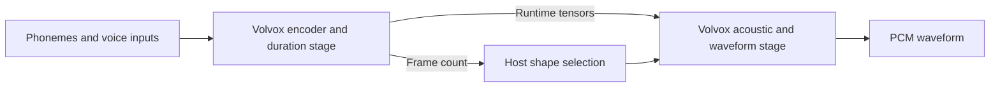

# TTS and neural vocoder operators

VolvoxAI executes complete Piper and Kokoro checkpoint computations through
ordinary graph execution. The application prepares phonemes and voice inputs;
one Volvox stage computes encoder features and durations, and another consumes
those live tensors to synthesize PCM. The host reads the predicted frame count
to choose tensor geometry. ONNX Runtime is used only for independent comparison.



Start with the [Piper](../examples/piper/README.md) or
[Kokoro](../examples/kokoro/README.md) workflow to download pinned assets, prepare
a request and write a WAV file. Their complete manifests are
`build/tts-examples/piper-full/manifest.json` and
`build/tts-examples/kokoro-complete/manifest.json`. The
[shared workflow](../examples/tts_common/README.md) covers native, WASM and
WebGPU execution and complete-pipeline benchmarks.

Prepared packages fix the token and frame extents. Each execution still runs
the duration stage and checks its result before running the acoustic stage.
A new browser request requiring different extents needs a newly prepared
package. Native preparation performs that specialization using a fresh Volvox
result. Phonemization, explicit Piper Gaussian noise, voice policy, sample rate
and playback remain application responsibilities.

## Execution and numerical qualification

Piper preparation checks individual stages with `rtol=1e-4, atol=1e-5`, with
exact duration counts and masks. Its complete waveform declares a peak error
limit of `1/32767` and an RMS limit of `0.1/32767`: one and one tenth of a PCM16
LSB. The stricter elementwise result remains visible in every comparison report.
The original voice noise scales stay enabled; explicit Gaussian inputs ensure
that both engines evaluate the same request.

Kokoro executes its complete model but currently fails the strict waveform
comparison. Its spectral phase is sensitive to small F32 changes. On the
recorded default CPU diagnostic with ONNX Runtime 1.23.2, Volvox versus the
original checkpoint had RMSE `0.00385`; enabling versus disabling the original
oracle's optimizer alone produced RMSE `0.00220`. Both failed the stated
criterion. The [phase-sensitivity workflow](../examples/kokoro/README.md)
retains waveform and spectral diagnostics without declaring parity or
perceptual equivalence.

The shared benchmark's `--report-waveform-differences` option records timings
and numerical failures together and returns exit code 3 for those differences.
Strict validation remains the default. Backend, shape, dtype and finiteness
checks apply in diagnostic mode as well. Qualification is tied to the exact
artifact and device recorded in a report; complete-model results and primitive
fixtures have separate reports.

## Export contracts

Use the [ONNX exporter](models.md) to package a graph and immutable weights,
then load and compile it through the normal inference API. Require a backend
with operator fallback forbidden to establish where every stage executes.
Native CPU and WASM are available in both profiles. Native CUDA, Vulkan,
OpenGL and Metal require the full profile; WebGPU uses `FullEngineHost` and
the full WASM artifact. The [public schema](../proto/volvoxai.proto),
[operator vocabulary](../proto/operator_vocabulary.proto) and
[generated kernel inventory](generated/kernel-registry.md) define the complete
API and registered contracts.

The exporter preserves the source channel-first interface and lowers spatial
work to existing channel-last kernels:

| Source operation | Supported execution |
| --- | --- |
| 1D `Conv` | H=1 `Conv2D` with layout conversion; regular, grouped and depthwise weights |
| 1D `ConvTranspose` | Phase-packed H=1 `Conv2D`, reshape and crop |
| Rank-3/4 `InstanceNormalization` | `GroupNorm` with one group per channel |
| `Exp`, `Sin`, `Cos`, `Sqrt`, `Log`, `Erf`, `Floor`, `Ceil`, `Round`, `Atan`, `Softplus`, `Neg` | Portable F32 unary operators |
| `Equal`, `GreaterOrEqual` | Matching F32 or I32 inputs, I32 Boolean output |
| `Less`, `LessOrEqual`, `Greater`, Boolean logic | Lowered comparisons and selection |
| Runtime `Pow` | Immutable scalar exponents 1, 2 or 3 lowered to identity or multiplication |
| `CumSum` | Linear-time F32 or I32 scan along the selected axis |
| `LSTM` | Default-activation F32 forward, reverse or bidirectional full-sequence output |

Conv1D supports explicit symmetric padding, stride and dilation. ConvTranspose
requires a concrete temporal length, group=1, dilation=1, output_padding=0 and
auto_pad=NOTSET. Its optional `output_shape` determines padding according to
ONNX semantics. Unsupported combinations fail export. Phase packing reuses
Conv2D kernels without allocating a zero-inserted activation. Model adapters can
express additional transformations explicitly; Kokoro's depthwise transposed
convolution uses a separate zero-insertion/grouped-convolution lowering.

LSTM accepts time-major X `[T,B,I]` and emits Y `[T,D,B,H]`, where D is one or
two directions. Bias and initial hidden/cell tensors are optional. Activations
are Sigmoid/Tanh/Tanh with separate input and forget gates. Sequence lengths
must be absent or immutable full lengths. Observable final-state outputs,
peepholes, gate clipping, custom activations and alternate layouts are refused.
GPU admission requires H at most 1024, alongside physical buffer, launch and
workspace proofs. This operator does not provide persistent cross-request state.

CumSum accepts negative axes, inclusive/exclusive and forward/reverse scans.
Graph parameters default to axis=0, exclusive=false, reverse=false; flags
accept booleans or integer 0/1. F32 adds in traversal order with F32 rounding;
I32 sums wrap modulo 2^32. GPU scans parallelize independent lanes and traverse
each lane once. Unary math preserves its declared special-value semantics;
device subnormal behavior can differ near zero. Runtime `Pow(x,0.5)` is not
rewritten to `Sqrt`: their signed-zero and negative-infinity behavior differs.

GPU GroupNorm computes centered variance with compensated F32 sums, preserving
small variations around a common offset. Duration regulation combines CumSum,
comparison masks and MatMul. Snake activations use
`x + sin(alpha*x)^2/alpha`. These operations work within declared shapes;
value-dependent frame allocation is handled at the stage boundary.

## Optimization and kernel fusion

ONNX export folds constants and recognizes supported patterns, including exact
erf GELU, normalization and linear bias. The registered typed optimizer then
simplifies shape/layout operations and removes dead code. Large repeated
constants can remain compact weights with an `Expand` operation. Export no
longer applies the obsolete 1,024-node or 2,048-tensor limits; runtime storage,
index limits and backend resource admission still apply.

Numerical migration, including Sigmoid/Mul to SiLU and selected quantized compute
islands, requires explicit options. Attention fusion also has separate policy
controls. Backend compilation can perform supported convolution/activation/add
fusions subject to topology and backend rules. These use registered kernels;
export does not generate an arbitrary custom GPU kernel for a complete model.

Read the export report and runtime route evidence to identify actual changes.
The prepared Piper duration graph recognizes 24 exact erf GELU patterns and
applies constant MatMul-to-Linear, transpose, shape-chain and dead-code rewrites.
Its acoustic graph primarily simplifies layouts. Lowered node counts include
layout operations and are not a fusion count or a speed measurement.

## W8A8 Quantization and vocoder QAT

TTS neural vocoders exhibit distinct sensitivity to quantization based on their
activation functions:

- **Contractive activations (Piper / VITS)**: LeakyReLU has a contractive
  derivative ($|f'(x)| \le 1$), so activation discretization noise naturally
  attenuates across layers (achieving SNR 18.6 dB under standard PTQ/QAT).
- **Periodic activations (Kokoro / StyleTTS2 / iSTFTNet)**: Snake activations
  ($x + \frac{1}{\alpha}\sin^2(\alpha x)$) have an oscillatory derivative
  ($1 + \sin(2\alpha x)$). Under naive post-training quantization (PTQ), activation
  discretization steps ($\Delta x \sim 1/128$) amplify across residual convolutional
  layers into high-frequency harmonic distortion (hissing noise with 3x–4x energy
  elevation above 4 kHz).

VolvoxAI provides a 4-part architectural solution for high-fidelity quantized TTS:

1. **A8 FakeQuantize forward hook with STE**:
   The native training runtime (`native/src/training/training_qat.inc`) injects
   dynamic symmetric INT8 activation grid discretization during forward evaluation:
   $$\hat{x} = \text{clamp}\left(\left\lfloor \frac{x}{S} \right\rceil, -128, 127\right) \cdot S$$
   During backward evaluation, a Straight-Through Estimator (STE) passes gradients
   directly to Conv2D weights ($\partial \hat{x} / \partial x = 1$ within the
   saturation range), allowing convolution weights to adapt and dampen periodic
   noise harmonics. Both WASM/CPU C and native CUDA backends (`test_cuda_qat_training.py`)
   support this path.
2. **Multi-Resolution STFT and Mel-spectrogram loss**:
   `tools/audio_spectral_loss.py` provides spectral convergence $\mathcal{L}_{\text{sc}}$
   and log-magnitude $\mathcal{L}_{\text{mag}}$ losses across multiple analysis
   windows (e.g. FFT sizes 1024, 2048, 512 with corresponding hops and window lengths).
   This loss penalizes high-frequency acoustic distortion during vocoder fine-tuning.
3. **PyTorch QDQ import bridge**:
   The ONNX exporter (`tools/exporter/frontend_onnx_recognize.py`, `tools/exporter/frontend_onnx_emit.py`)
   recognizes PyTorch `torch.ao.quantization` QuantizeLinear and DequantizeLinear
   pairs for Conv2D and Linear layers, lowering them directly to native `QConv2D` and
   `QLinear` operations with signed INT8 weights and runtime symmetric activation
   quantization, matching ONNX Runtime within 0–1 LSB.
4. **Grouped W8/F32 production baseline**:
   For deployments requiring immediate zero-noise execution without QAT fine-tuning,
   the Grouped W8/F32 profile quantizes all Linear layers (71 nodes in Kokoro) to INT8
   while retaining Conv2D layers (88 nodes) in FP32. This baseline eliminates activation
   discretization noise completely (waveform correlation 0.9997, 1.036x HF ratio) while
   reducing total weight payload.

## Reproduce primitive validation

Generate and run the shared NumPy-reference corpus:

```sh
python -m tools.generate_tts_validation --out build/tts-validation/cases.json
python tools/verify_tts_native.py --binary native/volvoxai-lite \
  --backend cpu --corpus build/tts-validation/cases.json \
  --out build/tts-validation/native-lite.json
node tools/verify_tts_web.mjs --backend wasm \
  --corpus build/tts-validation/cases.json --out build/tts-validation/wasm.json
```

The WASM runner checks both inference and full artifacts and repeats execution
on the same context. For native GPUs, use `native/volvoxai` with `--backend cuda`,
`vulkan`, `opengl` or `metal` on suitable hardware. For WebGPU:

```sh
deno run --no-config --unstable-webgpu -A tools/verify_tts_web.mjs \
  --backend webgpu --corpus build/tts-validation/cases.json \
  --out build/tts-validation/webgpu.json
```

Both runners require the requested backend and attest zero operator fallback.
Reports record artifact hashes and numerical differences. The corpus covers
composed duration/vocoder and normalization/Snake graphs, transcendental values,
CumSum axes/directions/modes for F32 and I32, signed wrap and bounded shapes.
Exporter tests cover shared convolution weights, output-shape padding, constant
inputs, grouped/depthwise Conv1D and the Piper spline/layout transformations.
Separate unary/comparison and LSTM fixtures exercise their contracts; use their
receipts and full-model reports to determine the qualified build and device.

See [the model contract](model-format.md) and [API discovery](api-discovery.md)
for package and execution details. Metal shader translation and planner checks
require numerical execution on Apple hardware to establish qualification.
